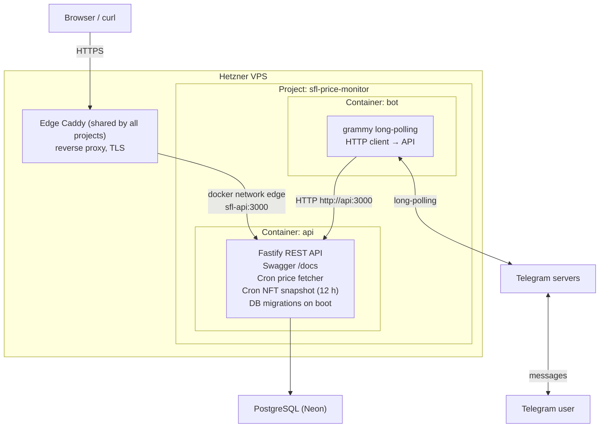

# Sunflower Land Price Monitor

Tracks in-game item prices from the Sunflower Land API, stores them as time-series data,
and exposes them over an authenticated REST API. A Telegram bot serves as the reference
client of that API.

## Architecture

### Design rationale

**The REST API is the product.** It has its own Swagger UI (`/docs`), JWT authentication,
and versioned endpoints. The bot is not a shortcut to the database — it is an authenticated
HTTP client that goes through the same public interface any future web or mobile client would.

**The bot is a separate process.** It runs its own event loop (grammy long-polling), has its
own minimal environment, and communicates with the API over HTTP. It does not import any
database or Fastify code. The boundary is enforced at the module level: `src/bot.ts` only
imports grammy and `src/modules/bot/`.

**JWT auth is designed for untrusted clients.** The full auth stack — access tokens,
rotating refresh tokens with reuse detection, per-user token revocation — is built and
covered by unit tests. Today only the bot uses it, and the bot takes a shortcut: it holds
the master `BOT_INTERNAL_SECRET`, so it re-authenticates directly via `POST /api/auth/login`
instead of rotating refresh tokens. Refresh rotation exists for the web/mobile client that
will arrive in the next iteration alongside personal price signals.

**Personal signals are the next iteration.** They are what justifies the auth model — a
signal (e.g. "notify me when Sunflower drops below X") is user-scoped data that must be
protected by a Bearer token. The cron engine already captures the time-series needed to
power signal evaluation.

### Planned delivery mechanism

Push notifications to the bot will go through an outbox table: the API writes a row, the
bot process polls or subscribes to it. This keeps the API and bot decoupled at the data
layer. Not yet implemented.

### Topology



> Both processes also run outside containers for local development (see "Running locally"
> below); the topology above is what `docker compose up` and production run.

### What is running vs what is designed

| Capability | Status |
|---|---|
| Time-series price storage (cron) | ✅ Running |
| Boosted NFT price history (12 h snapshots, idempotent) | ✅ Running; collected for signals, no endpoint yet |
| REST API with Swagger | ✅ Running |
| JWT access tokens (bot auth flow) | ✅ Running |
| Refresh token rotation + reuse detection | ✅ Designed, unit-tested; not used by bot (by design) |
| Telegram bot via grammy long-polling | ✅ Running |
| Bot as authenticated API client | ✅ Running |
| Personal price signals | 🔲 Next iteration |
| Push delivery via outbox | 🔲 Planned |
| Docker-compose + shared edge Caddy | ✅ Running |

## Running locally

Requires Node 24 (see `.nvmrc`) and a running PostgreSQL instance.

```bash
cp .env.example .env
# fill in DATABASE_URL, JWT_SECRET, BOT_INTERNAL_SECRET, TELEGRAM_BOT_TOKEN
nvm use
```

**Terminal 1 — API** (Fastify, migrations, cron):
```bash
node src/index.ts
```

**Terminal 2 — Bot** (grammy long-polling, calls the API):
```bash
node src/bot.ts
```

The bot defaults to `API_BASE_URL=http://127.0.0.1:3000`. If the API is not running,
the bot starts normally and replies to commands with a "service unavailable" message.

Swagger UI is available at `http://localhost:3000/docs`.

## Running with Docker Compose

Runs `api` and `bot` as containers, the same way production runs, with a local
overlay that publishes the API on `127.0.0.1:3000`:

```bash
cp .env.example .env
docker compose -f docker-compose.yml -f docker-compose.local.yml up --build
curl http://127.0.0.1:3000/health
```

Plain `docker compose up` is the production variant: it expects the external `edge`
network that exists only on the server, and fails without it. The overlay is
deliberately not named `docker-compose.override.yml` — compose would pick that up
automatically on the server too.

`DATABASE_URL` can point at a local Postgres or, as in production, at Neon —
see the comment in `.env.example` for why the direct (non-pooled) connection
string is required.

## Deployment

Production runs on a Hetzner Cloud VPS (x86, CX line) that hosts several projects,
with Neon as the managed Postgres and a Dynu domain. A single shared **edge Caddy**
(`/opt/edge` on the server, template in [`deploy/edge/`](deploy/edge/README.md)) is the
only container that publishes ports 80/443 and handles TLS via Let's Encrypt. This
project publishes no ports: `api` joins the external docker network `edge` under the
unique alias `sfl-api`, and its site file
([`deploy/caddy/sfl.caddy.example`](deploy/caddy/sfl.caddy.example)) is dropped into the
edge's `sites/` directory. Full step-by-step runbook, including server hardening and the
cloud firewall: [`docs/deploy-hetzner.md`](docs/deploy-hetzner.md).

`POST /api/auth/login` is blocked by the edge Caddy for external traffic —
only the `bot` container can reach it, over `http://api:<PORT>`. `ENABLE_SWAGGER=true`
is intended for production (see "Swagger is intentionally public" above).

## Environment variables

### API process (`src/index.ts`)

| Variable | Required | Default | Description |
|---|---|---|---|
| `DATABASE_URL` | ✅ | — | PostgreSQL connection string |
| `JWT_SECRET` | ✅ | — | Signing key, min 32 chars |
| `BOT_INTERNAL_SECRET` | ✅ | — | Shared secret for `POST /api/auth/login`, min 16 chars |
| `PORT` | | `3000` | HTTP port |
| `JWT_ACCESS_TTL` | | `15m` | Access token TTL |
| `REFRESH_TOKEN_TTL_DAYS` | | `30` | Refresh token TTL |
| `PRICES_API_URL` | | `https://sfl.world/api/v1/prices` | Upstream price source |
| `NFTS_API_URL` | | `https://sfl.world/api/v1/nfts` | Upstream NFT market source |

### Bot process (`src/bot.ts`)

| Variable | Required | Default | Description |
|---|---|---|---|
| `TELEGRAM_BOT_TOKEN` | ✅ | — | Token from @BotFather |
| `BOT_INTERNAL_SECRET` | ✅ | — | Must match the API's value |
| `API_BASE_URL` | | `http://127.0.0.1:3000` | API base URL; set to `http://api:3000` in compose |

## API

Full spec at `/docs` (Swagger UI) when the API is running.

**Swagger is intentionally public in production.** `POST /api/auth/login` is bot-only
and, behind the edge Caddy, unreachable from outside the server in the first place
(see `deploy/caddy/sfl.caddy.example`) — so there is no way to obtain a Bearer token through the public UI,
and protected routes cannot actually be invoked from it. The one field that used to leak
the bot's shared secret (`x-bot-secret` on the login route) has been removed from the
schema. Public docs with no working exploit path is a deliberate trade-off, not an
oversight.

Key endpoints:

| Method | Path | Auth | Description |
|---|---|---|---|
| `POST` | `/api/auth/login` | `x-bot-secret` header | Register/login via Telegram identity; returns access + refresh tokens |
| `POST` | `/api/auth/refresh` | refresh token in body | Rotate refresh token; reuse detection revokes the session |
| `GET` | `/api/auth/me` | Bearer | Current user info |
| `GET` | `/api/prices/latest` | Bearer | Latest price per item |
| `GET` | `/api/prices/history` | Bearer | Price history for an item |
| `GET` | `/api/prices/aggregate` | Bearer | Min/max/avg over a period |

## Development

```bash
npm run build   # tsc
npm test        # node:test, requires Node 24
```

Tests use `node:test` + `node:assert/strict` with no external test framework.
Database-touching code is tested with real queries against a test DB (see `authService.test.ts`).
HTTP clients (API client, price fetcher) use injected fake `fetch`.
